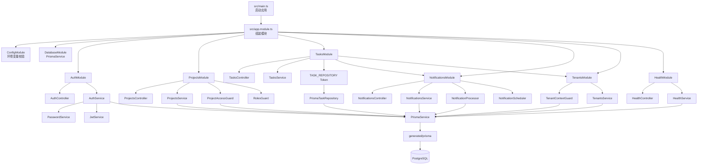

# 模块架构

这张图只描述静态模块和基础设施依赖，不描述请求执行顺序。请求生命周期见[对应知识文档](../knowledge/nest-request-lifecycle.md)。

## 关键边界

- `TasksService` 依赖 `TASK_REPOSITORY` 抽象，不直接依赖 Prisma 具体实现。
- `NotificationsModule` 同时提供 HTTP 查询和后台处理 Provider；通知处理不属于 HTTP 请求的必经步骤。
- `TenantContextGuard` 解析请求租户，业务 Service、Repository 和异步通知继续携带租户边界。
- `DatabaseModule` 是 Prisma 基础设施边界，业务模块通过 `PrismaService` 或 Repository 使用数据库。
- `HealthModule` 独立于业务模块，负责进程存活和数据库就绪检查。

## 维护入口

- 模块装配：[`src/app.module.ts`](../../src/app.module.ts)
- 任务边界：[`src/tasks/tasks.module.ts`](../../src/tasks/tasks.module.ts)
- 通知边界：[`src/notifications/notifications.module.ts`](../../src/notifications/notifications.module.ts)
- 数据库边界：[`src/database/database.module.ts`](../../src/database/database.module.ts)
