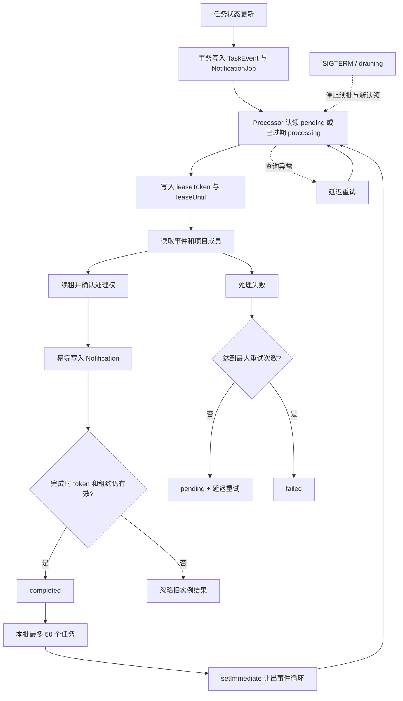
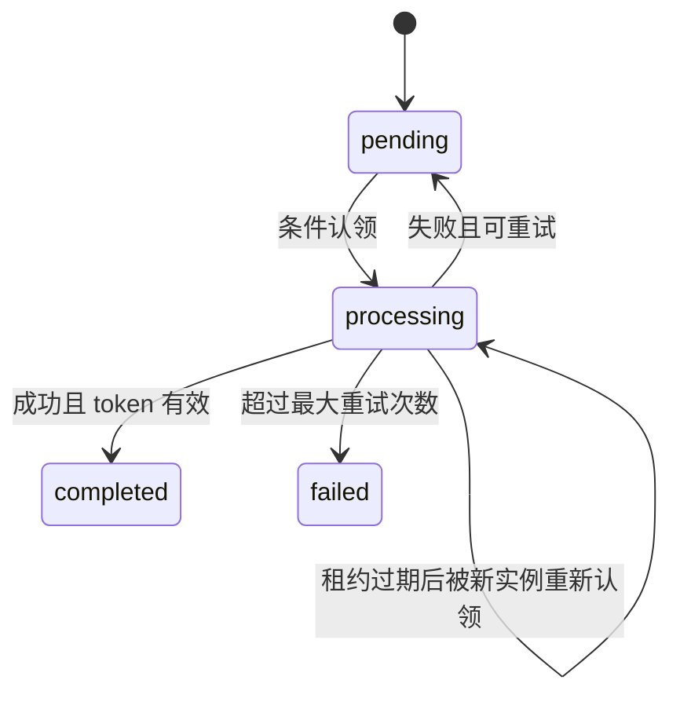

# 通知任务流程

任务状态更新和通知生成被拆成两个阶段：前一个事务只负责保存权威业务状态和 outbox 任务，后台处理器负责生成通知副作用。

## 状态机

## 必须保持的边界

- PostgreSQL 是 outbox 的权威状态源；租约只表示临时处理权，不代表恰好一次处理。
- `leaseToken` 区分处理尝试，旧实例不能用自己的令牌覆盖新实例的完成或失败结果。
- 通知写入依赖 `(userId, taskEventId)` 唯一约束和 `skipDuplicates` 实现幂等。
- `MAX_JOBS_PER_RUN = 50` 和 `setImmediate` 是应用内协作式背压，不是吞吐或容量承诺。
- 当前固定租约 30 秒、续期间隔 10 秒；正式容量结论仍需要 backlog、处理耗时和数据库压力证据。
- 停机排空只允许当前 `processJob` 收尾，不再认领下一任务；若进程被强制终止，后续实例依靠租约过期恢复。

## 代码与规格

- 处理器：[`src/notifications/notification.processor.ts`](../../src/notifications/notification.processor.ts)
- 任务状态事务：[`src/tasks/prisma-task.repository.ts`](../../src/tasks/prisma-task.repository.ts)
- 当前稳定规格：[`openspec/specs/task-notifications/spec.md`](../../openspec/specs/task-notifications/spec.md)
- 租约续期设计：[`openspec/changes/2026-10-10-notification-lease-renewal/design.md`](../../openspec/changes/2026-10-10-notification-lease-renewal/design.md)
- 背压设计：[`openspec/changes/2026-10-10-notification-throughput-backpressure/design.md`](../../openspec/changes/2026-10-10-notification-throughput-backpressure/design.md)
- 停机排空设计：[`openspec/changes/shutdown-drain/design.md`](../../openspec/changes/shutdown-drain/design.md)
