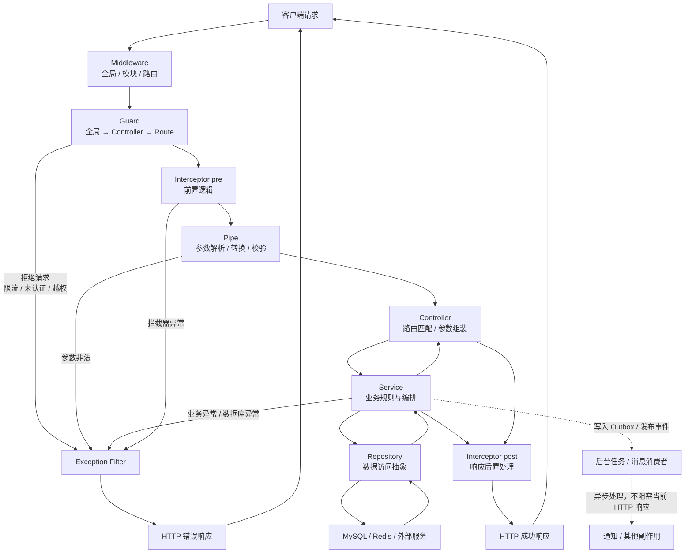

# NestJS 多场景请求生命周期

这张图同时描述成功请求、请求短路、异常处理和异步副作用。`Service` 与 `Repository` 属于应用架构层，不是 Nest 自动执行的生命周期钩子。

## 阅读要点

- `Middleware → Guard → Interceptor pre → Pipe → Controller` 是请求进入 Nest 处理链的大致顺序。
- Guard 或 Pipe 拒绝请求后，后续的 Controller、Service、Repository 都不会执行。
- `Interceptor post` 是前置拦截器包裹的后置逻辑，成功响应时最容易观察到。
- `Exception Filter` 是异常分支，不是每次请求都会经过的固定环节。
- 异步消费者已经脱离当前 HTTP 请求生命周期，不是响应返回前的必经步骤。
